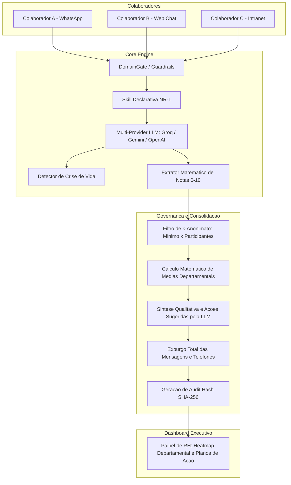

<div align="center">

# EQUILIBRA IA

**Plataforma de Avaliacao de Riscos Psicossociais em Conformidade com a NR-1 e Governanca LGPD**

*Arquitetura Headless com Multi-Provider LLM, Escuta Ativa Confidencial, k-Anonimato e Integracao Omnichannel (Web & WhatsApp Baileys / Meta Cloud API).*

[](https://www.typescriptlang.org/)
[](https://nodejs.org/)
[](https://expressjs.com/)
[](https://www.prisma.io/)
[](https://www.postgresql.org/)
[](https://github.com/WhiskeySockets/Baileys)
[](LICENSE)

<br/>

[Visao Geral](#visao-geral) |
[Fundamentacao NR-1](#fundamentacao-e-fatores-avaliados-nr-1) |
[Arquitetura de Seguranca & LGPD](#arquitetura-de-seguranca--governanca-lgpd) |
[Modulos do Sistema](#modulos-do-sistema) |
[Integracao WhatsApp](#integracao-whatsapp-real--simulador) |
[Configuracao e Execucao](#instalacao-e-execucao) |
[Variaveis de Ambiente](#variaveis-de-ambiente) |
[Pipeline de Consolidacao](#pipeline-de-consolidacao-e-expurgo)

---

</div>

## Visao Geral

O **Equilibra IA** e uma solucao corporativa desenvolvida para atender as diretrizes da **Norma Regulamentadora no 1 (NR-1)** do Ministerio do Trabalho e Emprego, estruturando a identificacao, mensuracao e mitigacao de **riscos psicossociais ocupacionais**.

Diferente de questionarios estaticos tradicionais de baixa adesao, o Equilibra atua por meio de um **canal conversacional empatico e institucional**. A inteligencia artificial conduz ativamente a escuta dos colaboradores, acolhe relatos qualitativos e extrai notas quantitativas (0 a 10) auditaveis por dimensao de risco, garantindo **preservacao de sigilo individual** e conformidade rigorosa com a **LGPD (Lei Geral de Protecao de Dados)**.

### Pilares Fundamentais

- **Escuta Ativa Humanizada sem Julgamentos:** Conducao estritamente profissional, sem diagnostico clinico, com acolhimento respeitoso e foco preventivo ocupacional.
- **Protocolo de Crise Imutavel:** Deteccao automatica de termos de alto risco (autolesao, desespero, ameacas a integridade) com suspensao de pesquisa e orientacao aos canais oficiais (CVV 188 e SAMU 192).
- **Governanca LGPD com k-Anonimato:** Exibicao de relatorios departamentais apenas quando o numero minimo de participantes for atingido (evitando a reidentificacao).
- **Expurgo e Destruicao de Logs Individuais:** Ao consolidar as medias matematicas e planos de acao do departamento, as conversas individuais e numeros de contato sao expurgados da memoria, gerando um hash criptografico de auditoria.
- **Motor LLM Multi-Provider:** Integracao com Groq (Llama 3.3 70B de altissima velocidade), Google Gemini, OpenAI e Ollama local, alem de suporte a Skills declarativas em JSON.

---

## Fundamentacao e Fatores Avaliados (NR-1)

A solucao se baseia nos dominios validados pelo modelo **COPSOQ II-Br** e nos termos de gerenciamento de riscos ocupacionais da **NR-1**:

| Fator Psicossocial | Descricao e Escopo da Avaliacao | Escala |
| :--- | :--- | :---: |
| **Demandas e Ritmo de Trabalho** | Volume de servico, prazos, pressao por metas e impacto da sobrecarga de trabalho. | 0 a 10 |
| **Autonomia e Decisao** | Margem de controle sobre as atividades, liberdade de propor melhorias e flexibilidade tecnica. | 0 a 10 |
| **Apoio da Lideranca** | Clareza no direcionamento das metas, disponibilidade da gestao imediata e feedback construtivo. | 0 a 10 |
| **Relacoes e Clima da Equipe** | Convivencia entre pares, espirito colaborativo, respeito interpessoal e integracao setorial. | 0 a 10 |
| **Reconhecimento e Valorizacao** | Justica organizacional, percepcao de merecimento e reconhecimento formal dos esforcos. | 0 a 10 |
| **Prevencao ao Assedio e Hostilidade** | Seguranca psicologica, ausencia de hostilidades, constrangimentos ou condutas abusivas. | 0 a 10 |

---

## Arquitetura de Seguranca & Governanca LGPD

O Equilibra IA foi projetado sob o conceito de **Privacy by Design**:



### Mecanismos de Protecao

1. **Calculo Matematico Determinante:** As notas de 0 a 10 sao capturadas e validadas diretamente da declaracao do colaborador. A IA nao inventa nem deduz notas por conta propria.
2. **Deteccao e Acolhimento em Crises:** Caso detectada situacao de vulnerabilidade extrema, o fluxo comum e interrompido imediatamente para fornecer os contatos de assistencia emergencial.
3. **Expurgo Pos-Consolidacao:** Historicos brutos de mensagens e identificadores de sessao sao limpos da memoria assim que o relatorio departamental e homologado.
4. **Audit Hash:** Cada relatorio consolidado armazena um hash criptografico imutavel que valida que a analise reflete o conjunto anonimizado daquele ciclo.

---

## Modulos do Sistema

O repositorio organiza servicos especializados em um monorepo modular em TypeScript:

```text
Equilibra-AI/
├── backend/
│   ├── public/                    # Interfaces Web prontas para operacao
│   │   ├── index.html             # Painel completo do RH: simulador, matriz de risco e consolidacao
│   │   ├── styles.css             # Design System escuro, institucional e sem emojis
│   │   ├── conectar-whatsapp.html # Central de pareamento QR Code com WhatsApp via Baileys
│   │   ├── whatsapp.html          # Simulador interativo da interface do colaborador
│   │   └── widget.js              # Script Headless injetavel com data-saas-*
│   ├── src/
│   │   ├── app.ts                 # Configuracao do Express, Middlewares de Seguranca e Rotas
│   │   ├── config/env.ts          # Validacao rigorosa de variaveis de ambiente com Zod
│   │   ├── middleware/            # Rate Limiting via Redis/Memory e Security Headers (Helmet/CORS)
│   │   ├── providers/             # Adaptadores de LLM (Groq, Gemini, OpenAI, Ollama)
│   │   ├── routes/
│   │   │   ├── equilibra.routes.ts # Endpoints de sessao, envio de respostas e consolidacao de relatorio
│   │   │   └── whatsapp.routes.ts  # Webhooks da Meta Cloud API e controles do Baileys
│   │   └── services/
│   │       ├── equilibra.service.ts # Regras de negocio da NR-1, maquina de estados e expurgo LGPD
│   │       ├── baileys.service.ts   # Conexao com WhatsApp Web via QR Code (Socket Baileys)
│   │       └── whatsapp.service.ts  # Normalizacao e roteamento de mensagens do WhatsApp
│   └── prisma/schema.prisma       # Modelagem multi-tenant para gestao empresarial
├── packages/
│   └── core/                      # Tipos compartilhados, schemas Zod e DomainGate
└── skills/
    └── equilibra-nr1.skill.json   # Configuracao da persona, regras de tom e restricao formal
```

---

## Integracao WhatsApp (Real & Simulador)

O Equilibra suporta dois modos de mensageria via WhatsApp:

### 1. WhatsApp Socket Direto (Baileys)
- Permite conectar um numero corporativo de WhatsApp escaneando um **QR Code diretamente na interface web** (`/conectar-whatsapp.html`).
- A IA inicia ativamente a conversa com o colaborador, conduz o questionario da NR-1, colhe notas e sincroniza com o dashboard em tempo real.
- Nao depende de aprovacao de templates da Meta para homologacao interna ou testes departamentais.

### 2. Meta WhatsApp Cloud API Oficial
- Endpoints prontos para receber eventos de webhook (`GET /api/whatsapp/webhook` para verification token e `POST /api/whatsapp/webhook` para processamento de mensagens recebidas).
- Envio estruturado de mensagens por meio da Graph API da Meta.

### 3. Simulador Integrado
- O painel em `/whatsapp.html` oferece uma interface grafica que reproduz a tela do WhatsApp Web, permitindo demonstrar e testar jornadas inteiras sem custos de telefonia.

---

## Instalacao e Execucao

### Pre-requisitos

- Node.js versao 20 ou superior
- npm versao 10 ou superior
- PostgreSQL (opcional para execucao com persistencia completa via Prisma)
- Chave de API de pelo menos um provedor de IA (Groq, Google Gemini ou OpenAI)

### 1. Clonagem e Instalacao de Dependencias

```bash
git clone https://github.com/TiagoFG-DEV/Equilibra-AI-Partial.git
cd Equilibra-AI-Partial
npm install
```

### 2. Configuracao do Ambiente

Crie o arquivo `.env` na raiz ou dentro da pasta `backend/` a partir do exemplo fornecido:

```bash
cp .env.example .env
```

### 3. Execucao do Servidor Backend

```bash
# Executar o backend com hot-reload (TypeScript)
npm run dev:backend
```

O servidor sera iniciado em `http://localhost:3000`.

### 4. Acesso as Interfaces

- **Painel do RH & Central de Analise:** `http://localhost:3000/index.html`
- **Conectar WhatsApp Real (QR Code):** `http://localhost:3000/conectar-whatsapp.html`
- **Simulador de Tela do Colaborador:** `http://localhost:3000/whatsapp.html`
- **Verificacao de Saude da API:** `http://localhost:3000/health`

---

## Variaveis de Ambiente

As principais configuracoes disponiveis no `.env`:

| Variavel | Descricao | Padrao |
| :--- | :--- | :---: |
| `PORT` | Porta de execucao do servidor HTTP | `3000` |
| `NODE_ENV` | Ambiente de execucao (`development`, `production`) | `development` |
| `AI_PROVIDER` | Provedor de IA ativo (`groq`, `gemini`, `openai`, `ollama`) | `groq` |
| `GROQ_API_KEY` | Chave de autenticacao na Groq Cloud | - |
| `GROQ_MODEL` | Modelo de LLM na Groq | `llama-3.3-70b-versatile` |
| `GEMINI_API_KEY` | Chave de autenticacao da Google AI Studio | - |
| `OPENAI_API_KEY` | Chave de API da OpenAI | - |
| `SKILLS_DIR` | Diretorio com arquivos declarativos de Skills | `../skills` |
| `WHATSAPP_SIMULATION_MODE` | Ativa simulador sem envio real | `true` |
| `WHATSAPP_TOKEN` | Bearer Token da Meta Cloud API | - |
| `WHATSAPP_PHONE_NUMBER_ID` | Identificador do numero na Meta Cloud API | - |
| `WHATSAPP_VERIFY_TOKEN` | Token de verificacao do Webhook da Meta | `equilibra-nr1-secret-token` |
| `REDIS_URL` | Instancia Redis para Rate Limiter distribuido | - |

---

## Pipeline de Consolidacao e Expurgo

Quando um ciclo departamental e encerrado pelo RH, o fluxo da API (`POST /api/equilibra/consolidate`) executa sequencialmente:

1. **Validacao de k-Anonimato:** Verifica se o departamento atingiu a amostra minima segura.
2. **Tabulacao Estatistica:** Calcula a media aritmetica auditavel por dimensao (Demandas, Autonomia, Lideranca, Clima, Reconhecimento e Assedio).
3. **Classificacao Automatica de Risco:**
   - **Risco Alto:** Media inferior a 5.0
   - **Risco Medio:** Media entre 5.0 e 6.9
   - **Risco Baixo:** Media igual ou superior a 7.0
4. **Sintese de Recomendacoes e Planos de Acao:** O provedor LLM recebe apenas os dados estatisticos e relatos sintetizados anonimos para redigir intervencoes preventivas com prazos e impactos sugeridos.
5. **Expurgo Criptografico dos Dados Individuais:** Os objetos de sessao, numeros e transcricoes sao descarregados da memoria e substituidos pelo Hash SHA-256 do relatorio consolidado.

---

## Licenca

Este projeto e distribuido sob a licenca **MIT**. Consulte o arquivo [LICENSE](LICENSE) para mais detalhes.
